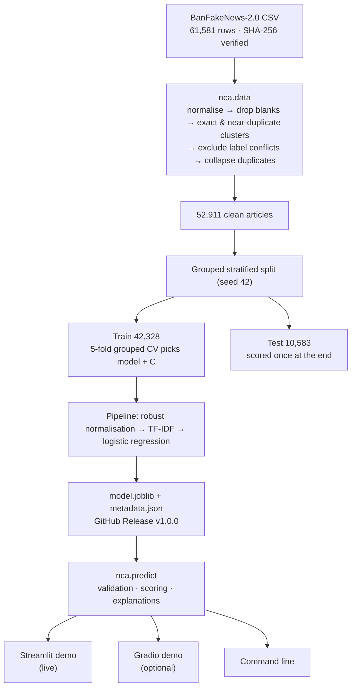

<div align="center">

# 📰 News Credibility Analyzer

**A leakage-free machine-learning classifier for Bangla (Bengali) news text, with an explainable live demo.**

<p>
  <a href="https://bangla-news-credibility-analyzer.streamlit.app">
    
  </a>
  &nbsp;
  <a href="https://github.com/devbyabir/news-credibility-analyzer/releases/tag/v1.0.0">
    
  </a>
  &nbsp;
  <a href="MODEL_CARD.md">
    
  </a>
</p>

<p>
  <a href="https://github.com/devbyabir/news-credibility-analyzer/actions/workflows/ci.yml"></a>
  
  
  
  <a href="LICENSE"></a>
</p>

<a href="https://bangla-news-credibility-analyzer.streamlit.app">
  
</a>

<sub>The demo runs on Streamlit Community Cloud. After a quiet period it may take a few seconds to wake up.</sub>

</div>

---

> [!IMPORTANT]
> **This is not a fact-checker.** The model estimates whether a text *resembles* the fake or the
> authentic articles in the BanFakeNews-2.0 dataset. It looks at wording and style only. It cannot
> check claims, sources or dates, and its output does not tell you whether a story is true.

## Contents

[At a glance](#at-a-glance) · [Highlights](#highlights) · [Results](#results) ·
[How it works](#how-it-works) · [Quick start](#quick-start) · [Data](#data) ·
[Limitations](#limitations) · [Documentation](#documentation) · [License](#license-and-attribution)

## At a glance

| | |
|---|---|
| **Task** | Score Bangla news text from authentic-like to fake-like, with per-word explanations |
| **Data** | BanFakeNews-2.0 (61,581 rows → 52,911 after audit and de-duplication) |
| **Model** | Robust text normalisation → TF-IDF word 1–2-grams → class-weighted logistic regression |
| **Result** | Macro F1 **0.956** and fake-class F1 **0.925** on an in-distribution held-out test split |
| **Speed / size** | 1.2 ms median per article on a laptop CPU · 7.0 MB model file |
| **Demo** | [Streamlit app](https://bangla-news-credibility-analyzer.streamlit.app) (plus an optional Gradio app) |
| **Quality** | 50 pytest tests, ruff, CI on Python 3.12 and 3.13, pinned and audited dependencies |

## Highlights

- 🧪 **Leakage-free evaluation.** The held-out test split is made before anything is fit. Exact
  *and* near-duplicate articles are grouped, so the same story never lands on both sides. Model
  selection uses grouped cross-validation on the training split only.
- 🔍 **Audited data.** A deterministic audit counts blank rows, exact and near duplicates, and label
  conflicts. Conflicting duplicates are excluded under a documented policy, never resolved silently.
- 🧭 **Shortcut analysis.** The first model's ~0.96 macro F1 relied partly on dates, bylines,
  COVID-era words and month names: traces of *when and where* each class was collected. The
  deployed model masks these cues, and the remaining bias is measured and documented.
- 💬 **Honest, explainable demo.** Five uncertainty bands with their held-out fake rates, the words
  that pushed the score each way, and clear messages for empty, oversized, non-Bangla or short input.
- 🔐 **Safe model delivery.** The hosted demo downloads the model from a GitHub Release and loads it
  only after its SHA-256 matches the committed value.
- ♻️ **Reproducible.** Pinned dependencies, a checksum-verified dataset download, fixed seeds and a
  saved split manifest.

## Results

All numbers come from [`reports/robust/test_results.json`](reports/robust/test_results.json) and
[`reports/baseline/test_results.json`](reports/baseline/test_results.json). The test split has
10,583 articles (1,606 fake, 8,977 authentic). Each candidate was scored on it once, after selection;
selection used only cross-validation on the 42,328 training articles.

**Deployed configuration: robust preprocessing** (dates, months, bylines and COVID-era words masked)

| Model | CV macro F1 (train, 5 folds) | Test macro F1 | Accuracy | Fake precision | Fake recall | Fake F1 | ROC-AUC | PR-AUC (fake) |
|---|---:|---:|---:|---:|---:|---:|---:|---:|
| Majority class (always "authentic") | 0.459 ± 0.000 | 0.459 | 0.848 | 0.000 | 0.000 | 0.000 | 0.500 | 0.152 |
| TF-IDF words + Complement NB | 0.915 ± 0.006 | 0.907 | 0.951 | 0.825 | 0.860 | 0.842 | 0.969 | 0.920 |
| **TF-IDF words + logistic regression (deployed)** | 0.954 ± 0.002 | **0.956** | 0.978 | 0.962 | 0.891 | **0.925** | 0.988 | 0.968 |
| TF-IDF words + linear SVM | 0.955 ± 0.002 | 0.958 | 0.979 | 0.964 | 0.894 | 0.928 | 0.989 | 0.970 |
| TF-IDF char n-grams + logistic regression | 0.952 ± 0.002 | 0.952 | 0.975 | 0.932 | 0.904 | 0.918 | 0.987 | 0.967 |

The linear SVM is marginally ahead. The selection rule, fixed in advance, required a model that
outputs probabilities (so the demo can show score bands); among those, logistic regression had the
best CV macro F1.

<p align="center">
  
  
  
</p>

<details>
<summary><b>More detail: confusion matrix, calibration, score bands and the unmasked baseline</b></summary>

- Confusion matrix (rows = dataset label): fake → 1,431 predicted fake / 175 predicted authentic;
  authentic → 56 / 8,921.
- Balanced accuracy 0.942 · Brier score (fake) 0.019 · ECE (10 bins) 0.014.

| Uncertainty band in the demo (P(fake)) | Test articles | Labelled fake in that band |
|---|---:|---:|
| Strongly authentic-like (< 0.2) | 8,789 | 1.1 % |
| Leans authentic-like (0.2–0.4) | 249 | 20.1 % |
| Uncertain (0.4–0.6) | 114 | 50.9 % |
| Leans fake-like (0.6–0.8) | 118 | 77.1 % |
| Strongly fake-like (≥ 0.8) | 1,313 | 99.5 % |

**Reference configuration: standard preprocessing** (no shortcut masking). The best model (char
n-gram logistic regression) reaches test macro F1 0.962 and fake F1 0.935, only 0.006 macro F1
above the deployed model. Its top features are dates and bylines
([reports/baseline/top_features.md](reports/baseline/top_features.md)), which is why it is not deployed.

</details>

> [!NOTE]
> These scores measure **in-distribution** separation of the two collections in BanFakeNews-2.0.
> They are not real-world fake-news or fact-checking accuracy. See [Limitations](#limitations).

**Not evaluated:** a fine-tuned BanglaBERT. Its training entry point exists and passed a CPU smoke
test, but a full run needs a GPU ([docs/FINETUNING.md](docs/FINETUNING.md)). No transformer
results are claimed.

## How it works



| Path | Purpose |
|---|---|
| `src/nca/labels.py` | Single source of truth for labels: `0 = fake`, `1 = authentic` |
| `src/nca/text.py` | Bangla normalisation, tokenizer and robust shortcut masking |
| `src/nca/data.py` | Pinned download, audit, near-duplicate clustering, grouped split |
| `src/nca/models.py` | Vectorizer and classifier factories |
| `src/nca/train.py` | CV model selection, final fit, test evaluation, reports |
| `src/nca/evaluate.py` | Metrics, calibration, uncertainty bands, figures |
| `src/nca/predict.py` | Input validation, scoring and explanations (library + CLI) |
| `src/nca/remote.py` | Checksum-verified model download for hosted demos |
| `src/nca/content.py` | Demo text shared by both web apps |
| `src/nca/finetune.py` | Optional BanglaBERT fine-tuning (GPU, not run at full scale) |
| `deploy/streamlit/streamlit_app.py` | Streamlit demo (the live app) |
| `app.py` | Gradio demo (optional Hugging Face Space) |
| `configs/` | `robust.json` (deployed) and `baseline.json` (unmasked reference) |
| `reports/` | Committed audit, CV results, test metrics, figures and failure cases |
| `legacy/` | The original 2025 notebook, kept for history. Its metrics are invalid. |

## Quick start

Requires Python 3.12 or newer (CI uses 3.12 and 3.13).

```bash
git clone https://github.com/devbyabir/news-credibility-analyzer.git
cd news-credibility-analyzer
python -m venv .venv
# Windows: .venv\Scripts\activate    macOS/Linux: source .venv/bin/activate
pip install -r requirements-dev.txt
pip install -e . --no-deps
pytest                      # 50 tests, no dataset needed
```

<details>
<summary><b>Run the demos, score text, or reproduce the model</b></summary>

Start the Streamlit demo (http://localhost:8501). Without a local model it downloads and verifies
the v1.0.0 release files:

```bash
streamlit run deploy/streamlit/streamlit_app.py
```

Gradio demo (http://127.0.0.1:7860) and the command line need a local model in `artifacts/model/`:

```bash
python app.py
python -m nca.predict "এখানে বাংলা সংবাদের লেখা ..."
```

Reproduce the data audit and the deployed model (about 25 minutes on a laptop CPU):

```bash
python -m nca.data download
python -m nca.train    # defaults: configs/robust.json -> reports/robust/, artifacts/model/
```

Reproduce the unmasked baseline:

```bash
python -m nca.train --config configs/baseline.json --reports reports/baseline --model-dir artifacts/baseline
```

</details>

## Data

BanFakeNews-2.0 by Hrithik Majumdar Shibu, Mendeley Data (2024),
doi:[10.17632/kjh887ct4j.1](https://doi.org/10.17632/kjh887ct4j.1), licensed **CC BY 4.0**. It is
downloaded from the Hugging Face mirror `hrshihab/BanFakeNews-2.0` at a pinned revision and checked
by SHA-256. The CSV is **not** included in this repository. The mirror is tagged Apache-2.0, but the
original Mendeley record (CC BY 4.0) is treated as authoritative. [docs/DATA.md](docs/DATA.md)
covers the audit, the conflict policy, the split design and the shortcut-cue analysis.

## Limitations

- **Style, source and period, not truth.** The authentic and fake articles were collected from
  different portals and periods. Masking obvious cues lowered the score only slightly, and the top
  remaining features still include portal names and spelling conventions. The test score shows how
  well the model separates *these* collections, not how well it would judge new Bangla news.
- **Out-of-distribution text** (new topics, recent events, other portals, social-media posts,
  headlines) can easily be misjudged. In an informal check, a hand-written ordinary 2025 economy
  report scored P(fake) = 0.66 before month masking and 0.55 ("uncertain") after it.
  In-distribution failures are listed in [reports/robust/failure_cases.md](reports/robust/failure_cases.md).
- **Label noise.** 6,825 rows sat in duplicate clusters that carried both labels and were excluded.
  Some noise probably remains among near duplicates.
- **Scores are model outputs.** Calibration is reported on the in-distribution test set only.
- **Not a moderation or fact-checking tool.** Do not use it to label real people's posts or to make
  decisions about content or people.

## Documentation

| Document | What it covers |
|---|---|
| [MODEL_CARD.md](MODEL_CARD.md) | Intended use, evaluation, known shortcuts, ethics |
| [docs/DATA.md](docs/DATA.md) | Dataset provenance, audit, split and shortcut analysis |
| [docs/DEPLOYMENT.md](docs/DEPLOYMENT.md) | Running locally and hosting (Streamlit, Hugging Face, others) |
| [docs/FINETUNING.md](docs/FINETUNING.md) | Optional BanglaBERT fine-tuning |
| [docs/RELEASE_CHECKLIST.md](docs/RELEASE_CHECKLIST.md) | Release record for v1.0.0 and a template for the next one |
| [reports/README.md](reports/README.md) | What each committed report file contains |
| [SECURITY.md](SECURITY.md) | How to report a vulnerability, and security design notes |

## Project history

The project began as a single Colab notebook (kept in [legacy/](legacy/)). A later review found that
the notebook reversed the labels, applied TF-IDF and SMOTE before cross-validation, kept duplicates
across folds, and used a tokenizer that split Bangla words at vowel signs, so its ~90 % accuracy is
invalid. This repository is the corrected rewrite.

## License and attribution

- **Code:** MIT ([LICENSE](LICENSE)), covering the code only; see [NOTICE.md](NOTICE.md).
- **Dataset:** BanFakeNews-2.0 © its author, CC BY 4.0. It is not redistributed here. Models and
  excerpts derived from it carry this attribution.
- **Screenshots** in `docs/assets/` come from this project's own demo. The demo's example texts were
  written for the demo and are not real news.

<div align="center">
<sub>Built by <a href="https://github.com/devbyabir">Abir Ahmmed</a></sub>
</div>
