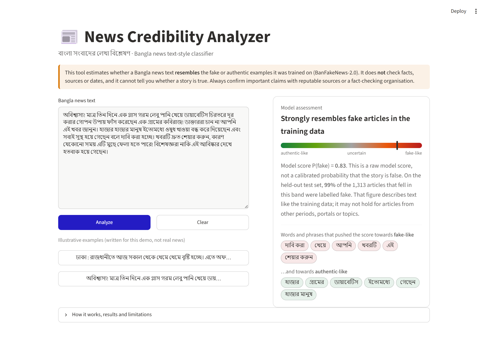
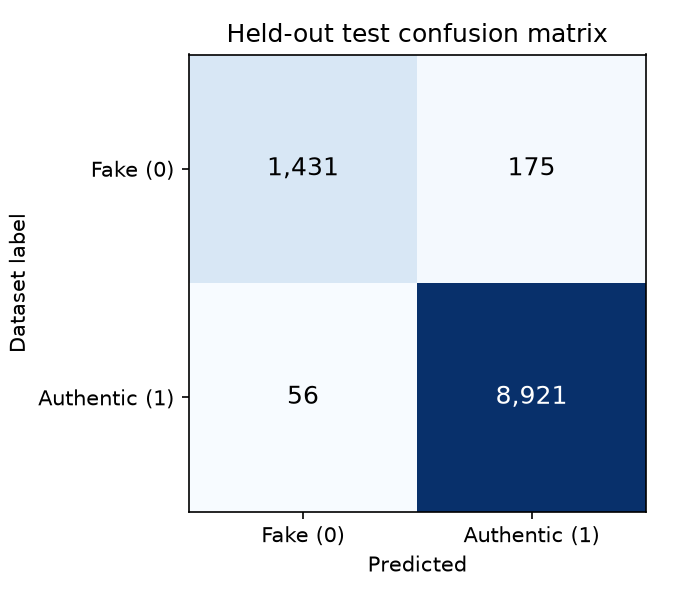
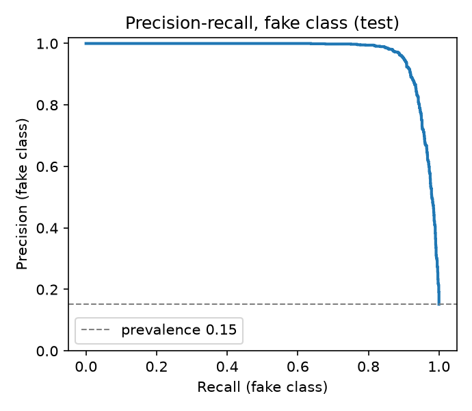
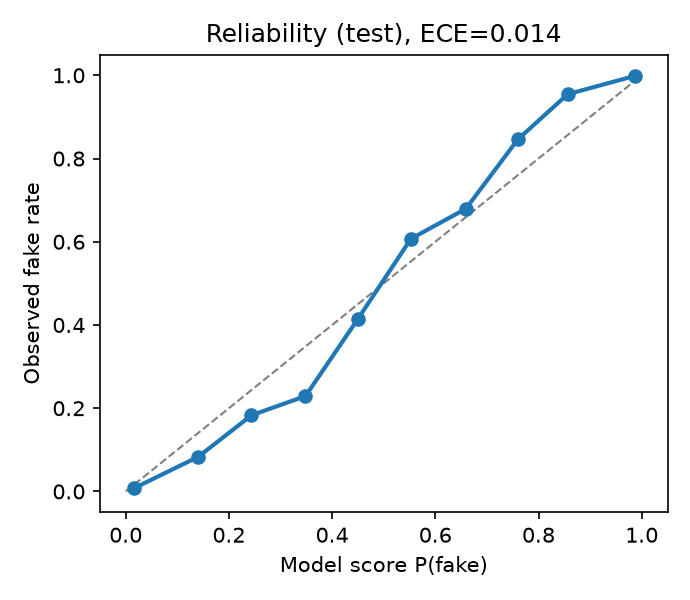

# News Credibility Analyzer

[](https://github.com/<your-github-username>/news-credibility-analyzer/actions/workflows/ci.yml)


A machine-learning classifier for **Bangla (Bengali) news text**. It estimates whether an article
*resembles* the fake or the authentic examples in the BanFakeNews-2.0 dataset, explains which words
drove the score, and runs as a small web demo.

> **It is not a fact-checker.** The model looks at wording and style only. It cannot check claims,
> sources or dates, and its output says nothing definitive about whether a story is true.

**Live demo:** not yet deployed. It is ready for Streamlit Community Cloud or Hugging Face Spaces; see [docs/DEPLOYMENT.md](docs/DEPLOYMENT.md). Replace this line with the public URL once it is live.



## Highlights

- **Leakage-free evaluation.** The held-out test split is created before anything is fit.
  Exact *and* near-duplicate articles are grouped, so the same story never appears on both sides,
  and model selection uses grouped cross-validation on the training split only.
- **Audited data.** A deterministic audit counts blank rows, exact and near duplicates and label
  conflicts. Conflicting duplicates are excluded under a documented policy, never resolved silently.
- **Shortcut analysis.** The first model's ~0.96 macro F1 relied partly on dates, bylines, COVID-era
  words and month names: artifacts of *when and where* each class was collected. The deployed model
  masks these cues. The remaining limitations are measured and documented.
- **Two web demos.** Streamlit and Gradio front-ends share one inference module.
  Hosted deployments download the model from a GitHub Release and verify its SHA-256 before loading it.
- **Honest product.** Uncertainty bands with held-out fake rates, per-word explanations, and
  explicit handling of empty, oversized, non-Bangla and short input.
- **Reproducible.** Pinned dependencies, a checksum-verified dataset download, fixed seeds, a saved
  split manifest, 30+ tests and CI.

## Results (held-out test set)

All numbers are copied from [`reports/robust/test_results.json`](reports/robust/test_results.json)
and [`reports/baseline/test_results.json`](reports/baseline/test_results.json). The test split has
10,583 articles (1,606 fake, 8,977 authentic). It was scored once per candidate after selection;
selection used only cross-validation on the 42,328 training articles.

**Deployed configuration: robust preprocessing** (dates, months, bylines, COVID-era words masked):

| Model | CV macro F1 (train, 5 folds) | Test macro F1 | Test accuracy | Fake precision | Fake recall | Fake F1 | ROC-AUC | PR-AUC (fake) |
|---|---:|---:|---:|---:|---:|---:|---:|---:|
| Majority class (always "authentic") | 0.459 ± 0.000 | 0.459 | 0.848 | 0.000 | 0.000 | 0.000 | 0.500 | 0.152 |
| TF-IDF words + Complement NB | 0.915 ± 0.006 | 0.907 | 0.951 | 0.825 | 0.860 | 0.842 | 0.969 | 0.920 |
| TF-IDF words + logistic regression **(deployed)** | 0.954 ± 0.002 | **0.956** | 0.978 | 0.962 | 0.891 | **0.925** | 0.988 | 0.968 |
| TF-IDF words + linear SVM | 0.955 ± 0.002 | 0.958 | 0.979 | 0.964 | 0.894 | 0.928 | 0.989 | 0.970 |
| TF-IDF char n-grams + logistic regression | 0.952 ± 0.002 | 0.952 | 0.975 | 0.932 | 0.904 | 0.918 | 0.987 | 0.967 |

The linear SVM is marginally ahead in CV. The selection rule fixed in advance requires a model
that outputs probabilities, so the demo can show score bands, and among those, logistic regression
had the best CV macro F1.

Deployed model on the test set:
- Confusion matrix (rows = dataset label): fake → 1,431 predicted fake / 175 predicted authentic;
  authentic → 56 / 8,921.
- Balanced accuracy 0.942. Brier score (fake) 0.019. ECE (10 bins) 0.014.
- Median CPU latency **1.2 ms** per article. Model file 7.0 MB.

<p>
  
  
  
</p>

**Reference configuration: standard preprocessing** (no shortcut masking): the best model
(char n-gram logistic regression) reaches test macro F1 0.962 and fake F1 0.935. This is only
0.006 macro F1 above the deployed model, but its top features are dates and bylines
([reports/baseline/top_features.md](reports/baseline/top_features.md)), which is why it is not deployed.

**Read these numbers with care.** They measure in-distribution separation of the two collections in
BanFakeNews-2.0. They do not measure accuracy on today's Bangla news. See *Limitations*.

| Uncertainty band in the demo (P(fake)) | Test articles | Labelled fake in that band |
|---|---:|---:|
| Strongly authentic-like (< 0.2) | 8,789 | 1.1 % |
| Leans authentic-like (0.2–0.4) | 249 | 20.1 % |
| Uncertain (0.4–0.6) | 114 | 50.9 % |
| Leans fake-like (0.6–0.8) | 118 | 77.1 % |
| Strongly fake-like (≥ 0.8) | 1,313 | 99.5 % |

**Not evaluated:** a fine-tuned BanglaBERT. The training entry point exists and passed a CPU smoke
test, but a full run needs a GPU ([docs/FINETUNING.md](docs/FINETUNING.md)). No transformer
results are claimed.

## How it works

```
BanFakeNews-2.0 CSV (61,581 rows, downloaded + SHA-256 verified)
        │  nca.data: normalise → drop blank → exact & near-duplicate clusters
        │            → exclude label-conflict clusters → collapse duplicates → split groups
        ▼
52,911 clean articles ──► grouped stratified split (seed 42)
        │                      ├── train 42,328 ──► 5-fold grouped CV: choose model + C
        │                      └── test  10,583 ──► scored once at the end
        ▼
Pipeline: robust normalisation → TF-IDF (word 1–2-grams) → class-weighted logistic regression
        ▼
artifacts/model/model.joblib + metadata.json ──► nca.predict ──► app.py (Gradio)
```

| Path | Purpose |
|---|---|
| `src/nca/labels.py` | Single source of truth: `0 = fake`, `1 = authentic` |
| `src/nca/text.py` | Bangla normalisation, tokenizer, robust shortcut masking |
| `src/nca/data.py` | Pinned download, audit, near-duplicate clustering, grouped split |
| `src/nca/models.py` | Vectorizer and classifier factories |
| `src/nca/train.py` | CV model selection, final fit, test evaluation, reports |
| `src/nca/evaluate.py` | Metrics, calibration, uncertainty bands, figures |
| `src/nca/predict.py` | Validation, scoring, explanations (CLI + library) |
| `src/nca/finetune.py` | Optional BanglaBERT fine-tuning (GPU) |
| `deploy/streamlit/streamlit_app.py` | Streamlit web demo (Streamlit Community Cloud) |
| `app.py` | Gradio web demo (Hugging Face Spaces) |
| `src/nca/content.py`, `src/nca/remote.py` | Shared demo text; checksum-verified model download for hosted demos |
| `configs/` | `baseline.json` (standard text) and `robust.json` (deployed) |
| `reports/` | Committed audit, CV, test metrics, figures, failure cases |
| `legacy/` | Original 2025 notebook, kept for history. Its metrics are invalid. |

## Quick start

Requires Python 3.12+ (tested on 3.14 locally; CI uses 3.12 and 3.13).

```bash
git clone https://github.com/<your-github-username>/news-credibility-analyzer.git
cd news-credibility-analyzer
python -m venv .venv
# Windows: .venv\Scripts\activate    macOS/Linux: source .venv/bin/activate
pip install -r requirements-dev.txt
pip install -e . --no-deps
```

Run the tests (no dataset needed):

```bash
pytest
```

Reproduce the data audit and the deployed model (~25 minutes on a laptop CPU):

```bash
python -m nca.data download
python -m nca.train    # defaults: configs/robust.json -> reports/robust/, artifacts/model/
```

Optional: reproduce the unmasked baseline benchmark:

```bash
python -m nca.train --config configs/baseline.json --reports reports/baseline --model-dir artifacts/baseline
```

Start the Streamlit demo at http://localhost:8501:

```bash
streamlit run deploy/streamlit/streamlit_app.py
```

Or start the Gradio demo at http://127.0.0.1:7860:

```bash
python app.py
```

Score text from the command line:

```bash
python -m nca.predict "এখানে বাংলা সংবাদের লেখা ..."
```

## Data

BanFakeNews-2.0, published by Hrithik Majumdar Shibu on Mendeley Data (2024),
doi:[10.17632/kjh887ct4j.1](https://doi.org/10.17632/kjh887ct4j.1), licensed **CC BY 4.0**.
It is downloaded from the Hugging Face mirror `hrshihab/BanFakeNews-2.0` at a pinned revision and
checked by SHA-256. The CSV is **not** included in this repository. The mirror is tagged
Apache-2.0, but the original Mendeley record (CC BY 4.0) is treated as authoritative.
[docs/DATA.md](docs/DATA.md) covers the full audit, the conflict policy, the split design and the
shortcut-cue analysis.

## Limitations

- **Style, source and period, not truth.** Authentic and fake articles were collected from
  different portals and periods. Masking obvious cues lowered the score only slightly, and the top
  remaining features still include portal names and spelling conventions. The test score
  therefore measures how well the model separates *these* collections. It does not show how well
  it would judge new Bangla news.
- **Out-of-distribution text** (new topics, recent events, other portals, social-media posts,
  headlines) can easily be misjudged. In an informal check, a hand-written, ordinary 2025 economy
  report scored P(fake) = 0.66 ("leans fake-like") before month masking and 0.55 ("uncertain")
  after it. In-distribution failures are listed in [reports/robust/failure_cases.md](reports/robust/failure_cases.md).
- **Label noise.** 6,825 rows sat in duplicate clusters that carried both labels and were
  excluded. Some noise likely remains in the near-duplicate range.
- **Scores are model outputs.** Calibration on the in-distribution test set is reported, but
  probabilities are not guaranteed for other kinds of text.
- **Not a moderation or fact-checking tool.** Do not use it to label real people's posts or to
  make decisions about content or people.

More detail: [MODEL_CARD.md](MODEL_CARD.md).

## Project history

The project began as a single Colab notebook (kept in [legacy/](legacy/)). A later review found that
the notebook reversed the labels, applied TF-IDF and SMOTE before cross-validation, kept duplicates
across folds, and used a tokenizer that split Bangla words at vowel signs. Its ~90 % accuracy is
therefore invalid. This repository is the corrected rewrite.

## License and attribution

- Code: MIT ([LICENSE](LICENSE)).
- Dataset: BanFakeNews-2.0 © its author, CC BY 4.0. It is not redistributed here. Models and
  excerpts derived from it carry this attribution.
- Screenshots in `docs/assets/` were captured from this project's own demo. The demo's example
  texts were written for the demo and are not real news.
